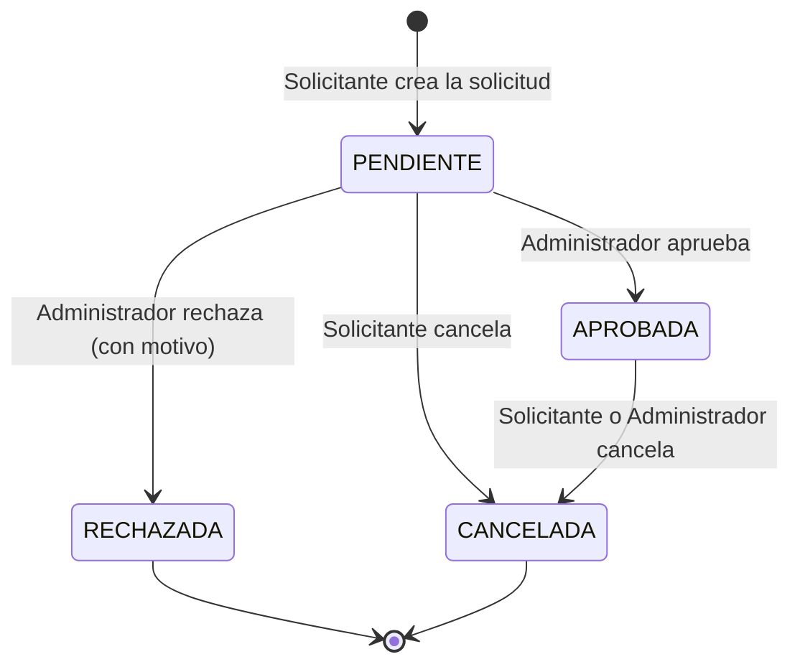

# PLAN DE INGENIERÍA — Sistema de Gestión de Reservas de Espacios Académicos

| Campo | Valor |
|---|---|
| Autor | Juan Sandón |
| Curso / Actividad | Ingeniería de Software aplicada con SDD y OpenSpec |
| Fecha | 23 de octubre de 2026 |
| Versión | 1.1 (plan inicial; corrección de fecha y cronograma, ver sección 8; el contenido técnico no cambió) |

> Este documento se redactó **antes** de instalar OpenSpec, de generar especificaciones y de escribir código. Es la base de la que se derivarán las especificaciones formales. Los cambios posteriores a este plan se registrarán en el `INFORME_FINAL.md`, no se reescribirá la historia de este documento.

---

## 1. Análisis del problema

### 1.1 Identificación de la problemática

Hoy la institución gestiona las reservas de laboratorios, auditorios y salas de cómputo por **correo electrónico y hojas de cálculo**. Ese mecanismo no tiene reglas que se hagan cumplir automáticamente, así que produce:

| Síntoma observado | Causa raíz | Consecuencia |
|---|---|---|
| Duplicidad de solicitudes | No hay un punto único donde se registren las solicitudes; varias personas piden lo mismo por canales distintos | Trabajo repetido del personal administrativo |
| Conflictos de horarios | La hoja de cálculo no impide que dos filas ocupen el mismo espacio a la misma hora | Dos grupos llegan al mismo laboratorio |
| Dificultad para consultar disponibilidad | La información está dispersa en correos y en una hoja que no todos ven actualizada | Los solicitantes piden "a ciegas" y reciben rechazos tardíos |
| Sin trazabilidad | Las aprobaciones, rechazos y cancelaciones quedan en hilos de correo | No se puede auditar quién decidió qué y cuándo |
| Sin control de permisos | Cualquiera con acceso a la hoja puede editarla | Riesgo de modificaciones indebidas |

**Problema central:** falta una fuente única y confiable de verdad sobre qué espacios existen y cuándo están ocupados, con reglas que impidan por construcción los conflictos.

### 1.2 Necesidades de la institución

| ID | Necesidad | Se traduce en |
|---|---|---|
| N1 | Centralizar el proceso de reservas | Un único sistema para solicitar, aprobar y consultar |
| N2 | Evitar conflictos de horario | Validación automática de disponibilidad y prevención de solapamientos |
| N3 | Consultar disponibilidad en cualquier momento | Consulta de espacios y de sus franjas ocupadas |
| N4 | Controlar quién puede hacer qué | Autenticación, roles y permisos |
| N5 | Formalizar la decisión sobre cada solicitud | Flujo de aprobación/rechazo con responsable y fecha |
| N6 | Auditar lo ocurrido | Historial de reservas y de cambios de estado |
| N7 | Poder adaptar reglas de negocio | Reglas de reserva aisladas en un único módulo para que cambien sin reescribir el sistema |

### 1.3 Actores involucrados

| Actor | Descripción | Qué necesita hacer |
|---|---|---|
| **Solicitante** (docente o estudiante) | Persona de la institución que necesita un espacio | Consultar disponibilidad, solicitar una reserva, cancelar la suya, ver su historial |
| **Administrador de espacios** | Personal encargado de gestionar los espacios y decidir solicitudes | Gestionar espacios y usuarios, aprobar/rechazar solicitudes, ver todo el historial |
| **Sistema** | Actor automático | Validar reglas, impedir solapamientos y registrar cambios de estado |
| **Institución (patrocinador)** | Define las reglas de negocio | Puede solicitar cambios de reglas durante el proyecto |

### 1.4 Alcance y limitaciones

**Dentro del alcance**

- Gestión de espacios académicos (laboratorio, auditorio, sala de cómputo): crear, consultar, editar, desactivar.
- Registro y administración de usuarios, con autenticación.
- Roles (Administrador, Solicitante) y permisos por rol.
- Creación de solicitudes de reserva con validación de disponibilidad.
- Prevención de reservas simultáneas en un mismo espacio.
- Aprobación y rechazo de solicitudes (con motivo).
- Cancelación de reservas e historial de reservas y de cambios de estado.
- Pruebas automatizadas y documentación.

**Fuera del alcance (decisión consciente)**

- Interfaz web de usuario final (se entrega una API REST documentada y usable desde Swagger UI).
- Notificaciones por correo o mensajería.
- Integración con el sistema académico de la institución (SSO, horarios de clase).
- Reservas recurrentes (ej. "todos los lunes").
- Gestión de equipamiento dentro de los espacios, pagos o inventario.
- Despliegue en producción (se documenta cómo ejecutarlo localmente).

**Supuestos**

- S1: Una reserva ocupa un espacio completo; no se reservan partes de un espacio.
- S2: Una reserva debe comenzar y terminar el mismo día (evita casos de medianoche).
- S3: Las franjas se tratan como intervalos semiabiertos `[inicio, fin)`: una reserva que termina a las 10:00 **no** choca con otra que empieza a las 10:00.
- S4: La zona horaria de referencia es la de la institución (Bogotá, UTC-5, sin horario de verano); internamente se guardan fechas en UTC.
- S5: La institución usa un único campus; no hay jerarquía de sedes.

**Limitaciones**

- Proyecto individual con plazo corto: se prioriza el núcleo (reservas y sus reglas) sobre funcionalidades accesorias.
- Persistencia ligera (SQLite) adecuada para el alcance académico, no para alta concurrencia institucional (ver sección 3.5).

---

## 2. Propuesta de solución

### 2.1 Descripción general

Se construirá un **backend centralizado expuesto como API REST** que gestione espacios, usuarios, roles y el ciclo de vida completo de una reserva. El sistema impone las reglas (disponibilidad, no solapamiento, permisos, flujo de aprobación) en el servidor, de modo que no dependen de que las personas las recuerden, como ocurre hoy con la hoja de cálculo.

Ciclo de vida de una reserva:



**Regla de ocupación:** una reserva en estado `PENDIENTE` o `APROBADA` **ocupa** el espacio. Las `RECHAZADA` y `CANCELADA` lo liberan.

### 2.2 Funcionalidades prioritarias (MoSCoW)

| Prioridad | Funcionalidad |
|---|---|
| **Must** | Autenticación; roles y permisos; gestión de espacios; creación de solicitudes; validación de disponibilidad; prevención de solapamientos; aprobación/rechazo; cancelación; historial |
| **Should** | Consulta de disponibilidad por espacio y fecha; filtros en listados; registro de quién y cuándo cambió el estado |
| **Could** | Paginación; endpoint de salud; datos semilla (seed) para demostración |
| **Won't (ahora)** | Interfaz web, notificaciones, reservas recurrentes |

### 2.3 Organización del sistema en módulos

| Módulo | Responsabilidad | Depende de |
|---|---|---|
| `usuarios` | Registro, consulta y administración de usuarios; autenticación (login/JWT) | — |
| `autorizacion` | Roles y verificación de permisos | `usuarios` |
| `espacios` | CRUD de espacios académicos, tipo y capacidad, estado activo/inactivo | `autorizacion` |
| `reservas` | Creación de solicitudes, estados, cancelación e historial | `usuarios`, `espacios` |
| `disponibilidad` | Consulta de franjas ocupadas y detección de conflictos | `espacios`, `reservas` |
| `politicas` | Reglas de negocio de reserva en un único lugar (duración mínima, mismo día, etc.) | `reservas` |
| `aprobacion` | Transiciones de estado decididas por el administrador | `reservas`, `autorizacion` |
| `nucleo` (core) | Configuración, conexión a BD, seguridad, manejo de errores | — |

### 2.4 Estrategia para desarrollar el proyecto progresivamente

Se usará **desarrollo incremental por rebanadas verticales**: cada etapa entrega una funcionalidad completa y probada (API + lógica + persistencia + pruebas), no capas sueltas. Así, al final de cada etapa existe un sistema que funciona y que se puede verificar.

Orden: cimientos y seguridad → catálogo de espacios → reservas (núcleo) → decisión del administrador → cancelación e historial → cambios de reglas y cierre. Detalle en la sección 4.

---

## 3. Decisiones de arquitectura y tecnología

### 3.1 Arquitectura seleccionada y justificación

**Monolito modular con arquitectura en capas.**

```
Cliente (Swagger UI / Postman / futura app)
        │  HTTP + JSON
        ▼
┌───────────────────────────────┐
│ Capa API (routers)            │  recibe y valida peticiones, devuelve respuestas
├───────────────────────────────┤
│ Capa de servicios             │  reglas de negocio, flujo de estados, permisos
├───────────────────────────────┤
│ Capa de repositorios          │  acceso a datos (consultas)
├───────────────────────────────┤
│ Base de datos (SQLite)        │
└───────────────────────────────┘
```

**Por qué:**

1. **Proporcionalidad.** El problema es acotado (un campus, un equipo de una persona). Un solo despliegue es más simple de construir, probar y explicar.
2. **Separación de responsabilidades.** Las reglas de negocio viven en servicios y políticas, no en los endpoints. Esto permite probarlas sin HTTP y modificarlas (nueva regla de negocio) en un único lugar.
3. **Mapeo directo a OpenSpec.** Cada módulo corresponde a una "capacidad" (spec) de OpenSpec, lo que facilita la trazabilidad requisito → código → prueba.
4. **Evolución posible.** Al estar modularizado por dominio, se podría separar en servicios más adelante si la institución lo necesitara.

### 3.2 Stack tecnológico propuesto

| Componente | Elección | Rol |
|---|---|---|
| Lenguaje | Python 3.12 | Lenguaje del sistema |
| Framework web | FastAPI | API REST con validación de datos incluida y documentación automática (Swagger) |
| Acceso a datos | `sqlite3` (módulo estándar de Python), SQL escrito a mano | Consultas parametrizadas y transacciones explícitas |
| Base de datos | SQLite (archivo local) | Persistencia sin instalar ningún servidor |
| Autenticación | JWT + hash de contraseñas con bcrypt | Sesiones sin estado y contraseñas protegidas |
| Pruebas | pytest | Pruebas automatizadas unitarias, de integración y de aceptación |
| Control de versiones | Git + GitHub | Historial verificable de la secuencia plan → specs → código |
| SDD | OpenSpec | Especificaciones, propuestas, tareas y archivo de cambios |
| Agente de IA | OpenCode | Implementación asistida según las especificaciones |

### 3.3 Estrategia de persistencia de datos

Base de datos **relacional**, porque el dominio tiene relaciones claras (usuario–reserva–espacio) y reglas de integridad.

Entidades principales:

| Entidad | Atributos clave |
|---|---|
| `Usuario` | id, nombre, correo (único), hash_contraseña, rol, activo |
| `Espacio` | id, nombre (único), tipo (LABORATORIO / AUDITORIO / SALA_COMPUTO), capacidad, activo |
| `Reserva` | id, espacio_id, usuario_id, inicio, fin, motivo, estado, decidido_por, decidido_en, motivo_decision, creada_en |
| `HistorialReserva` | id, reserva_id, estado_anterior, estado_nuevo, cambiado_por, cambiado_en, comentario |

Reglas de integridad:

- `fin > inicio` (restricción `CHECK`).
- Correo de usuario y nombre de espacio únicos.
- Claves foráneas entre reservas, usuarios y espacios.
- No se borra información: los espacios se **desactivan** y las reservas cambian de estado, para conservar el historial.

**Prevención de solapamientos (decisión crítica).** Dos intervalos `[a1, a2)` y `[b1, b2)` se solapan si y solo si `a1 < b2` **y** `b1 < a2`. La comprobación y la inserción se ejecutan en **una misma transacción** iniciada con `BEGIN IMMEDIATE`, que bloquea la escritura en SQLite antes de comprobar; así, dos solicitudes simultáneas no pueden pasar la validación a la vez. Solo se consultan reservas en estado `PENDIENTE` o `APROBADA` del mismo espacio.

**Seguridad en el acceso a datos.** Todas las consultas usan parámetros (`?`) y nunca concatenan texto del usuario dentro del SQL, para evitar inyección SQL. El esquema de tablas vive en un archivo `schema.sql` que se ejecuta al iniciar la aplicación.

### 3.4 Organización de componentes

```
reservas-academicas/
├── PLAN_INGENIERIA.md
├── INFORME_FINAL.md
├── README.md
├── openspec/                 # especificaciones, cambios y archivo
├── src/
│   └── app/
│       ├── main.py           # arranque de la aplicación
│       ├── nucleo/           # configuración, conexión sqlite3, schema.sql, seguridad, errores
│       ├── usuarios/         # router, servicio, repositorio, modelos, esquemas
│       ├── autorizacion/
│       ├── espacios/
│       ├── reservas/         # incluye política de reglas y flujo de aprobación
│       └── disponibilidad/
├── tests/
│   ├── unit/                 # reglas y servicios
│   ├── integration/          # API + base de datos
│   └── conftest.py
├── pyproject.toml / requirements.txt
└── .gitignore
```

Cada módulo repite la misma estructura interna (`router`, `service`, `repository`, `models`, `schemas`) para que sea predecible dónde está cada cosa.

### 3.5 Comparación de decisiones técnicas con alternativas descartadas

| # | Decisión | Alternativas descartadas | Por qué se eligió esta |
|---|---|---|---|
| D1 | **Monolito modular en capas** | Microservicios; arquitectura hexagonal completa | Los microservicios añaden complejidad operativa (red, despliegue, consistencia distribuida) que el problema no justifica. La hexagonal completa añade abstracciones excesivas para el tamaño del proyecto. El monolito modular ofrece separación suficiente con menor costo. |
| D2 | **FastAPI (Python)** | Django REST Framework; Flask; Node.js + Express | FastAPI genera documentación OpenAPI automática (útil para verificar la API contra las specs), valida con tipos y es ligero. Django trae mucho más de lo necesario; Flask exige armar manualmente validación y documentación; Express requeriría elegir y combinar más librerías. |
| D3 | **SQLite con el módulo `sqlite3` de Python** | PostgreSQL desde el inicio; MongoDB; ORM como SQLAlchemy | El dominio es relacional y requiere transacciones. SQLite no necesita instalar un servidor, así que cualquier evaluador ejecuta el proyecto con un comando, y `sqlite3` viene incluido en Python (cero dependencias). Escribir el SQL a mano hace visible cómo se evita el solapamiento y es un lenguaje que el estudiante domina; un ORM añadiría una capa extra que aprender. MongoDB dificulta las restricciones de integridad y las consultas de solapamiento. **Limitaciones asumidas:** SQLite no es ideal para alta concurrencia real, y migrar a otro motor exigiría revisar los repositorios (por eso el SQL está aislado en esa capa). |
| D4 | **Autenticación con JWT** | Sesiones en servidor con cookies; HTTP Basic | La API es sin estado y consumible desde cualquier cliente. Basic obliga a enviar credenciales en cada petición. Las sesiones requieren almacén de sesiones y están más ligadas a un navegador. |
| D5 | **Verificar solapamientos en el servicio dentro de una transacción** | Solo restricción en BD; bloqueo optimista con reintentos; cola de peticiones | Una restricción de exclusión por rangos solo existe de forma nativa en PostgreSQL (no en SQLite). La validación transaccional con `BEGIN IMMEDIATE` funciona en SQLite y devuelve mensajes de error claros. La cola añade infraestructura innecesaria. |
| D6 | **`PENDIENTE` también ocupa el espacio** | Solo `APROBADA` ocupa el espacio | Es el fallo exacto del proceso actual: varias solicitudes por el mismo horario. Bloquear desde que se solicita elimina duplicidad y simplifica la validación a una sola comprobación. **Costo asumido:** una solicitud pendiente puede retener un horario hasta que el administrador decida; se mitiga porque el administrador puede rechazarla. |
| D7 | **API REST sin interfaz web** | Aplicación web completa (React u otro) | El objetivo de la actividad es el proceso de ingeniería (plan → specs → código → pruebas), no el diseño visual. Swagger UI permite demostrar y probar todos los flujos. |

---

## 4. Estrategia de desarrollo

### 4.1 Metodología de trabajo

- **SDD (Spec-Driven Development) con OpenSpec** como columna vertebral: ningún comportamiento se implementa sin una especificación revisada.
- **Desarrollo incremental** por rebanadas verticales, con un cambio de OpenSpec por etapa.
- **Ciclo por cada cambio:** *proponer → revisar especificaciones → implementar → verificar → archivar*.
- **Control de versiones:** commits pequeños con prefijos convencionales (`docs:`, `spec:`, `feat:`, `test:`, `fix:`, `refactor:`). Un commit independiente por hito (el plan, cada propuesta, cada implementación). Rama `main` estable; una rama por cambio que se fusiona al terminar.
- **Tablero personal** (lista de tareas en `tasks.md` de cada cambio) como control de avance.

### 4.2 Etapas de implementación y criterios de terminado

| Etapa | Cambio OpenSpec | Contenido | Depende de | Criterio para considerarla terminada |
|---|---|---|---|---|
| E0 | (previa) | Plan de ingeniería, repositorio, entorno | — | `PLAN_INGENIERIA.md` en un commit independiente |
| E1 | `add-usuarios-autenticacion` | Registro de usuarios, login, JWT, contraseñas con hash | E0 | Todos los escenarios de la spec tienen prueba que pasa; contraseñas nunca en texto plano |
| E2 | `add-roles-permisos` | Roles Administrador/Solicitante y protección de endpoints | E1 | Matriz de permisos verificada con pruebas (acceso permitido y denegado) |
| E3 | `add-gestion-espacios` | CRUD de espacios, activación/desactivación | E2 | Solo el administrador modifica; espacios inactivos no aceptan reservas |
| E4 | `add-solicitud-reservas` | Crear solicitud, validar datos, disponibilidad, anti-solapamiento | E1, E3 | Ninguna prueba logra generar dos reservas activas solapadas, incluida una prueba de concurrencia |
| E5 | `add-aprobacion-reservas` | Aprobar y rechazar con motivo y registro de decisión | E2, E4 | Solo transiciones válidas del diagrama de estados; decisión queda registrada |
| E6 | `add-cancelacion-historial` | Cancelar, historial de cambios de estado, consulta de historial | E4, E5 | Cancelar libera el horario; el historial refleja cada transición |
| E7 | `add-limite-duracion-reserva` | Cambio de regla de negocio solicitado por la institución | E1–E6 | Specs actualizadas **antes**; nuevas pruebas pasan; pruebas anteriores siguen pasando |
| E8 | (cierre) | Verificación total, README, INFORME_FINAL | E7 | Suite completa en verde; documentación consolidada |

### 4.3 Dependencias entre componentes

```
usuarios ──► autorizacion ──► espacios ──► reservas ──► aprobacion
                  │                            │            │
                  └────────────────────────────┴────────────┴──► cancelacion/historial
                                               │
                                          disponibilidad
```

La seguridad va primero porque todas las funciones posteriores dependen de saber **quién** actúa y **qué puede hacer**. Los espacios van antes de las reservas porque una reserva siempre apunta a un espacio. La aprobación y la cancelación dependen de que la reserva exista y tenga estados.

### 4.4 Definición de "terminado" general (aplica a toda etapa)

1. Existe la especificación del cambio y fue **revisada** antes de implementar.
2. Cada escenario de aceptación tiene al menos una prueba automatizada.
3. Toda la suite de pruebas pasa (incluyendo las de etapas anteriores).
4. El código fue revisado por el estudiante (ver 6.4).
5. Los cambios están en Git con mensajes que referencian el cambio de OpenSpec.
6. El cambio fue archivado en OpenSpec y las specs principales reflejan el comportamiento real.

---

## 5. Estrategia de calidad

### 5.1 Tipos de pruebas

| Tipo | Qué verifica | Herramienta |
|---|---|---|
| Unitarias | Reglas de negocio aisladas (solapamiento, políticas, transiciones de estado) | pytest |
| De integración | Endpoint + lógica + base de datos reales (SQLite en memoria) | pytest + TestClient |
| De aceptación | Cada escenario `WHEN/THEN` de las specs convertido en prueba | pytest |
| De seguridad / permisos | Acceso permitido y denegado por rol; endpoints sin token | pytest |
| De concurrencia | Dos solicitudes simultáneas por el mismo horario: solo una prospera | pytest + hilos |
| De regresión | Reejecutar toda la suite tras cada cambio (en especial tras el cambio de regla) | pytest |
| Exploratoria manual | Recorrido de flujos completos desde Swagger UI | Navegador |

Objetivo: que **cada escenario de las especificaciones tenga al menos una prueba automatizada** y que todas pasen.

### 5.2 Riesgos identificados y mitigación

| ID | Riesgo | Prob. | Impacto | Estrategia de mitigación |
|---|---|---|---|---|
| R1 | La IA implementa funcionalidades no especificadas o interpreta mal un requisito | Alta | Alto | Implementar tarea por tarea; revisar cada diff contra la spec; rechazar código sin escenario asociado |
| R2 | Requisitos ambiguos o contradictorios entre specs y plan | Media | Alto | Fase de revisión obligatoria antes de implementar; checklist de consistencia contra este plan |
| R3 | Condiciones de carrera: dos solicitudes simultáneas ocupan el mismo horario | Media | Alto | Validación e inserción en una misma transacción; prueba de concurrencia explícita |
| R4 | Errores en bordes de intervalos y zonas horarias | Alta | Medio | Intervalos `[inicio, fin)` definidos en la spec; pruebas de borde (terminar exactamente cuando otra empieza); almacenamiento en UTC |
| R5 | Un cambio de regla de negocio rompe funcionalidades existentes | Media | Alto | Reglas centralizadas en el módulo de políticas; suite de regresión; cambio gestionado vía OpenSpec |
| R6 | Fallos de autorización (un solicitante ejecuta acciones de administrador) | Media | Alto | Matriz de permisos como spec; pruebas de acceso denegado por cada endpoint protegido |
| R7 | Deriva entre documentación, specs y código | Media | Medio | Archivar cada cambio para actualizar las specs; revisión de correspondencia en el cierre |
| R8 | Plazo corto: no alcanzar todo el alcance | Media | Alto | Priorización MoSCoW; etapas pequeñas con sistema funcional al final de cada una |
| R9 | Degradación del contexto del agente de IA en sesiones largas | Media | Medio | Sesiones nuevas por cambio; el contexto vive en los archivos de OpenSpec, no en el chat |

### 5.3 Mecanismos para verificar el cumplimiento de requisitos

**Matriz de trazabilidad** (se mantendrá en el informe final):

| Requisito (spec) | Escenario | Prueba automatizada | Archivo de código |
|---|---|---|---|
| (nombre del requisito) | (nombre del escenario) | `test_...` | `src/app/...` |

Convenciones:

- Cada prueba incluye en su nombre o docstring el escenario de la spec que verifica.
- Cada requisito se redacta con "SHALL" y con escenarios `WHEN/THEN` observables, de modo que sea verificable sin interpretación.
- En la Fase 5 se revisa que **todo escenario tenga prueba** y **todo comportamiento del código tenga escenario**.
- Se usa el verificador de OpenSpec (`openspec validate`) para comprobar el formato de las specs.

---

## 6. Uso de SDD e inteligencia artificial

### 6.1 ¿Cómo se utilizará OpenSpec?

OpenSpec organiza el trabajo en dos zonas: `openspec/specs/` (la fuente de verdad del comportamiento actual) y `openspec/changes/` (propuestas en curso). Para cada etapa se creará un **cambio** que contiene la propuesta (por qué), el diseño (cómo), los requisitos delta (qué cambia, con escenarios) y las tareas (pasos de implementación). Al terminar, el cambio se **archiva** y sus requisitos se fusionan en las specs principales. El ciclo es proponer → revisar → implementar → archivar.

### 6.2 ¿Cómo se transformará el plan de ingeniería en especificaciones?

| Sección del plan | Se convierte en |
|---|---|
| 1.2 Necesidades (N1–N7) | Objetivos y "por qué" de cada propuesta |
| 1.3 Actores y 2.3 Módulos | Una capacidad (spec) por módulo: `usuarios`, `autorizacion`, `espacios`, `reservas`, `disponibilidad`, `aprobacion` |
| 1.4 Alcance y supuestos S1–S5 | Restricciones y casos límite dentro de los requisitos |
| 2.1 Diagrama de estados | Requisitos de transiciones válidas e inválidas |
| 3.3 Persistencia e integridad | Restricciones en los requisitos y decisiones en `design.md` |
| 3.5 Decisiones D1–D7 | `design.md` de cada cambio (decisión + alternativas) |
| 4.2 Etapas | Un cambio de OpenSpec por etapa, con su `tasks.md` |
| 5.2 Riesgos | Escenarios de prueba negativos y de borde |

Cada requisito se escribirá con "SHALL" y con al menos un escenario `WHEN/THEN`, incluyendo casos de error.

### 6.3 ¿Qué actividades se delegarán a la IA y cuáles no?

| Se delega a la IA | Queda bajo responsabilidad del estudiante |
|---|---|
| Redactar borradores de propuestas, specs y tareas a partir del plan | Decidir los requisitos, las reglas de negocio y su prioridad |
| Generar código siguiendo una tarea concreta | Elegir y justificar la arquitectura y el stack |
| Proponer casos de prueba y escribir su código | Aprobar o rechazar cada especificación antes de implementar |
| Refactorizaciones menores y correcciones de estilo | Revisar cada diff y responder por el código entregado |
| Sugerir escenarios límite que se me hayan olvidado | Decidir qué cambios de plan son válidos y registrarlos |
| Borradores de documentación (README) | Verificar que los resultados y conclusiones sean verdaderos |

### 6.4 ¿Cómo se verificará el código generado?

Para cada tarea implementada por el agente:

1. **Revisión del diff** (`git diff`) leyendo todo lo que cambió, no solo lo pedido.
2. **Correspondencia:** ¿cada función nueva responde a un requisito o escenario? Si no, se elimina.
3. **Pruebas:** se ejecuta la suite completa; se comprueba que las pruebas realmente fallan si se rompe la lógica (no son triviales).
4. **Arquitectura:** el código respeta las capas (sin lógica de negocio en routers ni consultas SQL en servicios).
5. **Seguridad:** endpoints protegidos, sin secretos en el código, contraseñas con hash, consultas SQL parametrizadas.
6. **Commit** pequeño con referencia al cambio y a la tarea.

### 6.5 Reglas de control (guardrails)

- No se escribe código de una funcionalidad cuya especificación no esté revisada.
- No se modifica el comportamiento sin actualizar primero la especificación mediante un cambio de OpenSpec.
- Una sesión del agente por cambio, con el contexto cargado desde los archivos de OpenSpec.
- Si el agente propone algo fuera de la spec, se rechaza o se convierte primero en un cambio especificado.

---

## 7. Cronograma

| Fecha | Trabajo |
|---|---|
| 23 oct (tarde) | Plan de ingeniería (commit independiente), repositorio, instalación y `openspec init`; especificaciones de todos los módulos y su revisión (Fases 1 y 2) |
| 23 oct (noche) | Implementación E1–E6, cambio de regla (E7), verificación y cierre (E8): README e INFORME_FINAL |
| 24 oct (antes de las 7:30) | Entrega del repositorio. La actividad permite varios envíos: se entrega la versión más avanzada disponible y se actualiza si queda tiempo |

---

## 8. Control de cambios de este documento

| Versión | Fecha | Cambio | Motivo |
|---|---|---|---|
| 1.0 | 21 oct 2026 (fecha mal indicada) | Versión inicial | Etapa 1 de la actividad |
| 1.1 | 23 oct 2026 | Corrección de la fecha del documento y del cronograma | Error al calcular las fechas al redactar la v1.0; el contenido técnico no cambió |

*(Las decisiones que cambien durante el desarrollo se documentarán en `INFORME_FINAL.md`.)*
